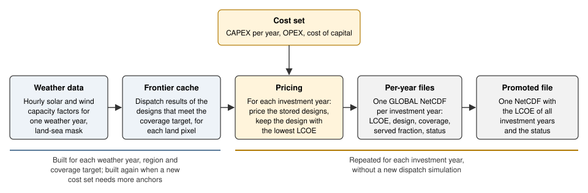

# Architecture

This page shows where in the code each step of BOA runs. It gives the data flow, the commands and
the modules of `src/boa/`, with links to the [API reference](api-reference.md). For the method
itself, see [Search algorithm](methodology.md). For the meaning of each term, see the
[Glossary](glossary.md).

## Data flow

**Figure 1.** The BOA pipeline. The blue steps depend only on the weather. They store no cost. The
cache build reads the costs only to place the anchors. The yellow and grey steps apply the costs,
once for each investment year. The yellow step is the [query](glossary.md#query). See the
[Overview](overview.md) for the concepts.

The table gives the code for each step in Figure 1.

| Step | What the code does | Code |
|---|---|---|
| Weather data | Reads the hourly solar and wind capacity factors of one region from the profile store of the input set (Zarr by default). Reads the weather year from the file names of the stores. | [open_regional_dataset][boa.inputs.profiles.open_regional_dataset], [detect_weather_year][boa.inputs.profiles.detect_weather_year] |
| Anchors (part of the cache build) | Lists each pair of [investment year](glossary.md#investment-year) and [cost key](glossary.md#cost-key) with its cost coefficients, and selects the [anchors](glossary.md#anchor). The anchors place the patches of the search. | [cost_candidates][boa.model.anchors.cost_candidates], [anchors_for_build][boa.model.anchors.anchors_for_build] |
| [Frontier cache](glossary.md#frontier-cache) | For one region: selects the land pixels, builds the frontier of each pixel in parallel threads, and writes one Zarr store for the region. | [build_frontier_cache_for_region][boa.model.global_extension.build_frontier_cache_for_region], [build_pixel_frontier][boa.model.bisection.build_pixel_frontier], [write_frontier_cache][boa.model.frontier_cache.write_frontier_cache] |
| Query | For one region and one investment year: reads the store and finds the cost key of each pixel. Then it calculates the cost coefficients and keeps the stored design with the lowest LCOE. It writes one regional NetCDF file. | [query_frontier_cache_for_region][boa.model.global_extension.query_frontier_cache_for_region], [lcoe_coefficients][boa.model.cost_calculations.lcoe_coefficients], [argmin_lcoe][boa.model.bisection.argmin_lcoe] |
| Per-year files | Puts the regional files of one investment year on one global grid. | [combine_regional_datasets_into_global_dataset][boa.model.global_extension.combine_regional_datasets_into_global_dataset] |
| Promoted file | Puts the LCOE of all investment years of a run in one file, with the provenance. | [promote_lcoe][boa.model.lcoe_promotion.promote_lcoe] |

The cost set enters at two places. At the query,
[process_global_baseload_simulation_costs][boa.inputs.costs.process_global_baseload_simulation_costs]
reads one investment year from the cost workbook. At the cache build, the anchors use the costs
of all investment years of the run. They use them only to place the patches. The stored values
contain no cost. The load density enters only at the query. It sets the absolute demand of each
pixel, and it does not change the LCOE (see [Overview](overview.md)).

The functions [build_all_caches][boa.cli.run_simulation.build_all_caches] and
[query_all_years][boa.cli.run_simulation.query_all_years] run these steps for all regions and all
investment years.

## Commands

Each console script is a function in `boa.cli`. For the options of each command, see
[Running the model](running-the-model.md).

| Command | Code | What it does |
|---|---|---|
| `boa-run` | [main_run][boa.cli.run_simulation.main_run] | Builds the frontier caches that are missing or that do not cover the costs of the run. Then it runs the query for every investment year. It can also write the promoted file. |
| `boa-run build-cache` | [main_build_cache][boa.cli.run_simulation.main_build_cache] | Builds the frontier caches only. |
| `boa-run query` | [main_query][boa.cli.run_simulation.main_query] | Runs the query on the existing frontier caches only. |
| `boa-run point` | [main_point][boa.cli.run_simulation.main_point] | Runs one location without a frontier cache (see below). |
| `boa-promote-lcoe` | [boa.cli.promote_lcoe][boa.cli.promote_lcoe] | Writes the promoted file for a finished run. |
| `boa-cds-download`, `boa-cds-prepare` | [boa.cli.run_cds][boa.cli.run_cds] | Download the raw weather files, and build the Zarr stores of the weather data. |
| `boa-data-prepare` | [boa.cli.data_prepare][boa.cli.data_prepare] | Installs the static geographic data and the cost workbook of a cost set. |
| `boa-lcoe` | [boa.cli.lcoe_pipeline][boa.cli.lcoe_pipeline] | Runs three steps in this order: `boa-data-prepare`, then `boa-cds-prepare` (it can use the republished copy of the weather data), then `boa-run` with promotion. It runs `boa-run` once for each coverage value. |

A single-point run
([execute_single_point_baseload_power_simulation][boa.model.single_point_run.execute_single_point_baseload_power_simulation])
reads the weather of the region of the location. It builds the frontier of this one pixel with
[build_pixel_frontier][boa.model.bisection.build_pixel_frontier]. It uses the cost coefficients of
this pixel as the anchor. Then it runs the query with
[argmin_lcoe][boa.model.bisection.argmin_lcoe]. It does not write a frontier cache. The run reads
the maximum-capacity store of the region and logs the limits. It does not apply them (see
[Known limitations](known-limitations.md)). The run always makes the plots of the point.

## Module map

The package `boa` has these parts. Names are paths from `boa`.

### Model

| Module | Content |
|---|---|
| [boa.model.bisection][boa.model.bisection] | The search for one pixel. It has the hourly dispatch ([dispatch_metrics][boa.model.bisection.dispatch_metrics]), the smallest battery for a design ([b_min_at][boa.model.bisection.b_min_at]), the coarse grid, the seeds and the patches ([build_pixel_frontier][boa.model.bisection.build_pixel_frontier]). It also has the query of a frontier ([argmin_lcoe][boa.model.bisection.argmin_lcoe]) and the search settings ([SearchParams][boa.model.bisection.SearchParams]). The stored dispatch results depend on no cost, no year and no capacity ceiling. `build_pixel_frontier` takes anchor cost coefficients, but only to place the patches. `argmin_lcoe` takes the cost coefficients of the query. |
| [boa.model.frontier_cache][boa.model.frontier_cache] | The schema and the file format of the frontier cache, and the functions that write and read it. The cache holds dispatch results only. |
| [boa.model.anchors][boa.model.anchors] | The anchors: the cost coefficients that decide where the search puts its patches. |
| [boa.model.cost_calculations][boa.model.cost_calculations] | The cost coefficients of a cost key and an investment year, and the cost breakdown of a design. |
| [boa.model.global_extension][boa.model.global_extension] | The build and the query of one region, and the combination of the regions into the GLOBAL dataset. |
| [boa.model.lcoe_promotion][boa.model.lcoe_promotion] | The promoted LCOE file. |
| [boa.model.single_point_run][boa.model.single_point_run] | The single-point run, and the choice of the cost key and the costs for a location. |
| [boa.model.logic][boa.model.logic] | The dispatch rules as plain functions, for example [state_of_charge][boa.model.logic.state_of_charge]. `dispatch_metrics` is the fast version of the same rules, and the tests compare the two. Other code also uses this module. `search_box` in `boa.model.bisection` calls `overscale_mus_from_cf` to set the scale of the search box. The single-point run calls `return_global_average_costs` for the cost fallback. It calls `calculate_net_energy_production` and `state_of_charge` for the state of charge of the chosen design. |
| `boa.model.diagnostics` | Optional plots of a run, and the plots of a single point. See [Running the model](running-the-model.md#plots). |

### Inputs and geography

| Module | Content |
|---|---|
| [boa.inputs.profiles][boa.inputs.profiles] | Opens the regional stores of the weather profiles and of the maximum capacity. |
| [boa.inputs.costs][boa.inputs.costs] | Reads the cost workbook and gives the costs of one investment year for each cost key. |
| [boa.geo.geospatial][boa.geo.geospatial] | Country mappings, and the selection of the land pixels in a region with the land-sea mask. |
| [boa.geo.iso3_finder][boa.geo.iso3_finder] | The country and the province of a pixel, from the per-pixel ISO3 grid. This gives the cost key. |
| [boa.geo.iso3_grid_builder][boa.geo.iso3_grid_builder], [boa.geo.geo_hierarchy][boa.geo.geo_hierarchy] | Build the ISO3 grid and the table of countries and provinces from the Natural Earth data. |
| `boa.geo.geo_hierarchy_overrides` | The hand-checked settings that `boa.geo.geo_hierarchy` applies to the table of provinces. They cover China. |

### Weather-data preparation

| Module | Content |
|---|---|
| [boa.cds.spec][boa.cds.spec], [boa.cds.download][boa.cds.download] | The names of the Copernicus Climate Data Store (CDS) datasets, and the download of the raw files. |
| [boa.cds.convert][boa.cds.convert] | Converts the raw files to the regional Zarr stores of the profiles. |
| [boa.cds.max_capacity][boa.cds.max_capacity], [boa.cds.availability][boa.cds.availability] | Build the regional stores of the capacity ceiling from the pixel area and the optional land-availability layers. The query does not apply the ceiling (see [Known limitations](known-limitations.md)). The function `pixel_area` also gives the area of a pixel to `boa.model.global_extension` and `boa.model.single_point_run`. |
| [boa.cds.install][boa.cds.install] | Moves finished stores to the folder that the model reads. |
| [boa.store_schema][boa.store_schema] | The chunking, the format and the file names of the stores. The writers in `boa.cds` and the reader `boa.inputs.profiles` share it. |
| `boa.conversions` | Changes a grid resolution to the text in the store file names (for example, 0.25 becomes `025`). |

### Configuration

| Module | Content |
|---|---|
| [boa.config.paths][boa.config.paths] | The folder layout of the data root, in `PathConfig`. |
| [boa.config.run_manifest][boa.config.run_manifest] | The provenance record `run.json` of a run, and the hash of the search settings. |
| [boa.config.physical_parameters][boa.config.physical_parameters] | The physical and economic constants, and the rectangles of the regions. See [Model assumptions](model-assumptions.md). |
| `boa.config.constants` | Unit constants and the status codes. |
| `boa.config.data_packages` | The address and the checksum of each published data package. |
| `boa.fetch`, `boa.fsutil` | Download of a package with a checksum, and replacement of a folder. |

## Dependencies between the parts

- `boa.config` imports no other part of BOA at module level, with one exception.
  `boa.config.run_manifest` imports the search settings from `boa.model.bisection`. It also
  imports `boa` for the version. It imports `boa.cds.install` and `boa.inputs.profiles` only
  inside functions.
- `boa.geo`, `boa.inputs` and `boa.cds` import from `boa.config`. `boa.inputs.costs` also imports
  from `boa.geo.geospatial`.
- `boa.model` imports from `boa.config`, `boa.inputs` and `boa.geo`. `boa.model.global_extension`
  and `boa.model.single_point_run` also import the function `pixel_area` from
  `boa.cds.max_capacity`.
- `boa.cli` imports from all other parts.
- BOA does not import from Steel-IQ. Steel-IQ reads the promoted LCOE file (see
  [The promoted LCOE file](promoted-lcoe-file.md)).

The frontier cache depends only on the weather. Its path contains the weather year, the coverage
target and a hash of the search settings, so a change to a search setting makes a different cache.
See [Running the model](running-the-model.md) for the folder layout.
