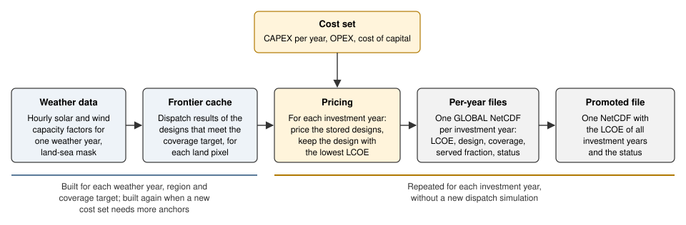

# Overview

This page explains what BOA calculates and what one value of the **levelised cost of
electricity (LCOE)** means. It also explains how the coverage target changes the cost, and why
the LCOE does not change with the load density. The [Glossary](glossary.md) gives the meaning of
each technical term.

## What BOA calculates

BOA finds a low-cost system of solar panels, wind turbines and batteries that supplies a
constant electricity demand at one location. The demand is the same in each hour of the year. We
call it the **baseload demand**.

BOA does this calculation for each land **pixel** of a set of **regions**. A pixel is one cell of
the ERA5 weather grid, 0.25 degrees in latitude and in longitude. A pixel is land when the ERA5
land-sea mask is more than 0.5. Together, the regions cover most land between about 58° S and
72° N. For each pixel, BOA uses:

- the hourly solar and onshore wind **capacity factors** of one **weather year**. A capacity
  factor is the power that 1 MW of installed capacity gives in that hour, as a fraction of 1 MW;
- a **coverage target**: the fraction of hours in which the system must supply the full demand;
- the costs of the **cost key** of the pixel: its country, or its province where the cost set
  gives costs for each province. The costs are the capital cost (CAPEX) of each technology in
  each investment year, the operating cost (OPEX) and the cost of capital. When the cost set has
  no costs for the province, BOA uses the costs of the country. When the cost set has no costs
  for the country, BOA uses the mean costs of all cost keys in the cost set.

For each **investment year**, the result for one pixel is the system with the lowest LCOE that
the search finds among the systems that meet the coverage target. BOA writes the LCOE, the system
design, the coverage that the design achieves, its served fraction and a **status code** for
each pixel. The status code is a number that tells whether BOA found a result for the pixel, and
if not, why (see [Pixels without a result](#pixels-without-a-result)).

BOA works in two steps. First, it simulates the hourly operation of many systems at each pixel,
and it stores the systems that meet the coverage target in the **frontier cache**. Then, for each
investment year, it applies the costs to the stored systems and keeps the system with the lowest
LCOE.



**Figure 1.** The BOA pipeline. The left part (blue) simulates the hourly operation of the
systems. BOA builds it for each weather year, region and coverage target. The right part (yellow
and grey) applies the costs. BOA repeats it for each investment year without a new simulation of
the hourly operation. A cost set can make BOA build the left part again (see
[Build once, price many](#build-once-price-many)).
The [promoted LCOE file](promoted-lcoe-file.md) is the file that other models, for example
Steel-IQ, read.

The hosted web front end at [boa.systemiq.earth](https://boa.systemiq.earth) runs an earlier
version of the BOA method. Its results can be different from the results that this package
calculates.

## The design of a system

BOA describes a system with three numbers that are relative to the demand. The demand of a pixel
is set to 1. Thus the design does not depend on the size of the demand.

| Number | Meaning | Unit |
|---|---|---|
| Solar factor | Installed solar capacity divided by the demand | MW per MW of demand |
| Wind factor | Installed wind capacity divided by the demand | MW per MW of demand |
| Battery factor | Battery energy capacity divided by the demand | hours of demand |

We call the solar factor and the wind factor **overscale factors**. They are usually larger
than 1, because solar and wind give less than their installed capacity in most hours.

Example: a design with solar factor 3, wind factor 1.5 and battery factor 8, for a demand of
100 MW, has 300 MW of solar, 150 MW of wind and an 800 MWh battery.

## How the system operates in each hour

BOA simulates the operation of each design for all hours of the weather year. We call this
simulation the **dispatch**. These are the rules in each hour:

1. Solar and wind generation goes to the demand first.
2. When the generation is more than the demand, the surplus charges the battery. When the
   battery is full, the remaining surplus is lost. We call this lost energy **curtailment**.
3. When the generation is less than the demand, the battery supplies the difference, as far as
   its charge permits.
4. An hour is **covered** when the generation and the battery together supply the full demand.

The battery is empty at the start of the weather year. The model has no battery losses, and it
does not limit the charge or discharge power of the battery: only the energy capacity is a
limit. There is no grid connection and no other source of electricity. The
[Methodology](methodology.md) page gives the exact dispatch rules.


**Figure 2.** One week of hourly dispatch at one synthetic pixel with strong sun and some wind,
at a coverage target of 0.85. In the day, solar generation is much larger than the demand. The
surplus fills the battery, and the battery supplies the demand in the night. Near the end of each
night the battery is empty, and the demand is not fully met (shaded hours). In the afternoon of
days 3 to 6, the battery becomes full, and the remaining surplus is curtailed. The profiles are
synthetic: they come from the generators in the test fixtures, without seasons. The script is
`docs_figures/overview_figures.py`.

## Coverage and served fraction

BOA uses two different measures of how well a system supplies the demand:

- **Coverage** is the fraction of hours of the weather year in which the system supplies the full
  demand. An hour with only part of the demand supplied counts as not covered. The coverage
  target is a fraction larger than 0 and smaller than 1, for example 0.85 for 85 % of the hours.
- **Served fraction** is the fraction of the annual demand energy that the system supplies. An
  hour with part of the demand supplied adds that part.

The coverage target is the constraint: each design that the search keeps has a coverage at or
above the target. The output files store the coverage with a resolution of 1/65 535, so the
output value can be slightly below the target, for example 0.94999 for a target of 0.95.

The served fraction sets the energy that the LCOE divides by (see the next section). Because a
partly supplied hour adds to the served fraction but not to the coverage, the served fraction is
always equal to or larger than the coverage.

BOA does not supply the uncovered part of the demand from another source, and it does not
include the cost of such a source. Thus the LCOE is the cost for each MWh that the system
delivers, not the cost to supply the full demand (see [Known limitations](known-limitations.md)).
To estimate the cost to supply the full demand, start from the per-year output variable
`lcoe_coverage_based`. It is `lcoe × served_fraction`: the cost of the system for each MWh of the
full demand. Then add `(1 - served_fraction) × P`, where `P` is the cost in USD/MWh of the other
source, from a different model.

## What one LCOE value means

The LCOE of a pixel is the cost of the system for each MWh that it delivers to the demand, in
USD per MWh. It is the total discounted cost of the system divided by the total discounted energy
that it delivers to the demand over the **investment horizon**. It is not the cost to supply the
full baseload demand, because the uncovered part of the demand has no cost in BOA.

- **The cost** contains the CAPEX of the solar, wind and battery capacity in the investment year,
  and the OPEX in each year of the horizon. The OPEX of a technology is a fixed fraction of its
  CAPEX in the investment year. BOA discounts each year with the cost of capital of the pixel's
  country.
- **The energy** is the served fraction multiplied by the annual demand, in each year of the
  horizon. Curtailed energy is not in the energy, because it does not reach the demand.
- **The investment horizon** is the longest technology lifetime. All three lifetimes are 25
  years, so the horizon is 25 years and BOA does not install a technology again in the horizon.
  The [model assumptions](model-assumptions.md) page gives the lifetimes and their sources.

BOA uses the same weather year for each year of the horizon, and the output of the system does
not decrease with age. The currency year of the LCOE is the currency year of the cost workbook.

??? note "The LCOE formula"
    For a design with solar factor `s`, wind factor `w` and battery factor `b`, BOA calculates

    ```text
    LCOE(s, w, b) = (a_s * s + a_w * w + a_b * b**GAMMA) / (d0 * served_fraction)
    ```

    The four cost coefficients `a_s`, `a_w`, `a_b` and `d0` come from the costs of one
    investment year and one cost key
    ([lcoe_coefficients][boa.model.cost_calculations.lcoe_coefficients]). `a_s`, `a_w` and
    `a_b` are the discounted lifetime costs of one unit of each factor. `d0` is the discounted
    demand energy over the horizon, with 8760 hours in each year. `GAMMA` is 0.85: the battery
    cost per MWh decreases when the battery duration in hours of demand increases. `GAMMA` is
    1 plus the battery scaling factor of −0.15; the
    [model assumptions](model-assumptions.md) page gives this factor. [argmin_lcoe][boa.model.bisection.argmin_lcoe] evaluates
    this formula for each stored design and returns the design with the lowest value.

## How coverage changes the LCOE

A higher coverage target needs a system that also supplies the demand in the difficult hours:
long nights, wind lulls, or both at the same time. To cover these hours, the system needs a
larger battery, more solar or wind capacity, or a different mix. Each design that meets a high
target also meets each lower target. Thus, over all possible designs, the lowest LCOE cannot
decrease when the coverage target increases.

In Figure 3, the resource of the pixel has a larger effect on the LCOE than the coverage target.


**Figure 3.** LCOE of the search result against the coverage target for four synthetic pixels.
The LCOE is an index: the mixed pixel at coverage 0.50 is 100. Each value is the cost per MWh
delivered, not the cost to supply the full demand. The vertical axis is logarithmic. The
poor-resource pixel costs about 9 to 11 times as much as the solar-only pixel, and about 12 to 14
times as much as the mixed pixel. The solar-only pixel costs more than the mixed pixel, because
it must store energy for each night. The curves are not smooth: at some steps, the LCOE
decreases when the coverage target increases, for example on the mixed pixel from 0.66 to 0.68.
These steps come from the search, which does not always find the lowest-cost design. They are
not a property of the pixel (see [Known limitations](known-limitations.md)). The profiles are
three weeks of synthetic data from the generators in the test fixtures, without seasons, and the
costs are the illustrative values of the test fixtures. Do not use the size of the change in this
figure as an estimate for a real pixel. The script is `docs_figures/overview_figures.py`.

## Why the LCOE does not change with the load density

The **load density** is the demand for each km² of pixel area, in MW/km². The pixel area is the
full area of the grid cell, land and water. BOA multiplies the load density by the area of each
pixel to get the demand of that pixel in MW. The area of a pixel decreases with latitude: at
1 MW/km², a pixel at the equator has a demand of about 773 MW, and a pixel at 60 degrees latitude
has a demand of about 386 MW.

The LCOE does not change with the load density, for these reasons:

1. BOA finds the design with the demand set to 1. Thus the solar, wind and battery factors do
   not depend on the demand.
2. Each cost of the system is proportional to the installed capacity, and thus to the demand.
   The battery cost per MWh depends on the battery duration in hours, which is also relative to
   the demand.
3. The delivered energy is also proportional to the demand.

When the demand doubles, each cost and the delivered energy double. The ratio, the LCOE, stays
the same, apart from rounding in the last digits of the floating-point numbers. The load density
changes only the absolute values in the output: the demand in MW and the installation costs.

This is true because BOA does not limit the solar and wind capacity of a pixel by the land that
is available. We call that limit the **capacity ceiling**. BOA can calculate the capacity
ceiling, but it does not apply it when it selects a design. Each output file records this as
`capacity_ceiling_applied = 0`. A capacity ceiling in MW is the same for each load density, but
the demand of the pixel increases with the load density. Thus, with a capacity ceiling, the
result would depend on the load density. See [Known limitations](known-limitations.md).

## Build once, price many

The slow part of BOA is the dispatch simulation. To find a low-cost design, BOA must simulate
many designs for all hours of the weather year. The fast part is the [query](glossary.md#query): when the dispatch
result of a design is known, its LCOE is a short formula.

BOA keeps these two parts apart:

- **Build.** For each pixel, BOA examines a **coarse grid** of solar and wind factors. At each
  node of this grid, it calculates only a **lower bound** on the **minimum battery**: the
  smallest battery that meets the coverage target. With these bounds, BOA selects a small number
  of **seeds**: nodes that can give a low LCOE. Around each seed, it builds a **patch**: a fine
  grid of designs. At each patch node, BOA finds the minimum battery. These designs are the
  **frontier**: with the same solar and wind factors, a smaller battery does not meet the target.
  BOA stores the patch designs and their dispatch results in the frontier cache. The stored
  dispatch results contain no cost, no investment year and no load density.
- **Query.** For each investment year, BOA calculates the cost coefficients of each pixel from
  its costs. Then it prices each stored design and keeps the cheapest. This step does no
  dispatch simulation.


**Figure 4.** Build once, price many. The build simulates the dispatch for the weather and the
coverage target. The query applies the costs. One cache serves all investment years of a run.
The dashed line is the only path from the costs to the build: a small set of **anchors** (sets
of cost coefficients) tells the search where to put the patches. Thus the anchors decide which designs the cache
contains, but the dispatch result of each stored design contains no cost.

As a result, each investment year needs only the query step, not a new dispatch simulation. A
different coverage target, weather year or set of search settings needs a different cache.

The cache depends on the costs in one way: through the anchors. When BOA builds a cache, it
first compares the anchors of the stored cache with the cost mixes of all cost keys and
investment years of the run. When the stored anchors do not cover these cost mixes, BOA builds
the cache again with more anchors. The new cache can have different patches. Thus the LCOE for an
earlier cost set and investment year can change after this rebuild. A run that only prices a
stored cache does not do this comparison: it uses the cache that it finds. BOA identifies a cache
by the weather-year label, the region, the coverage target and the search settings, not by the
content of the weather data. [Running the model](running-the-model.md) gives the details, and
[Known limitations](known-limitations.md) describes the effects on the results.

The search uses grids of designs. Thus the result is the best design that the search found, not
an exact optimum. For each result, BOA also does a **containment check**: it checks whether the
lower bound on the LCOE at each coarse node outside the patches is at or above the LCOE of the
result. The output files do not record the result of this check. The [Methodology](methodology.md) page explains the search and its
precision.

## Pixels without a result

Some pixels have no LCOE. In the output files of a regional or global run, their LCOE is NaN. A
single-point run reports an LCOE of 0 for such a pixel. The status code of the pixel tells why:
[Known limitations](known-limitations.md#status-codes) gives the meaning of each code. The status
code is the same for all investment years, because the build sets it without costs.
